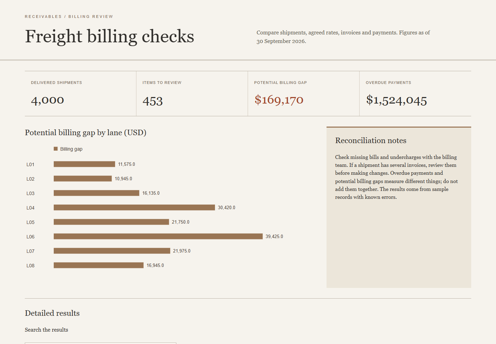
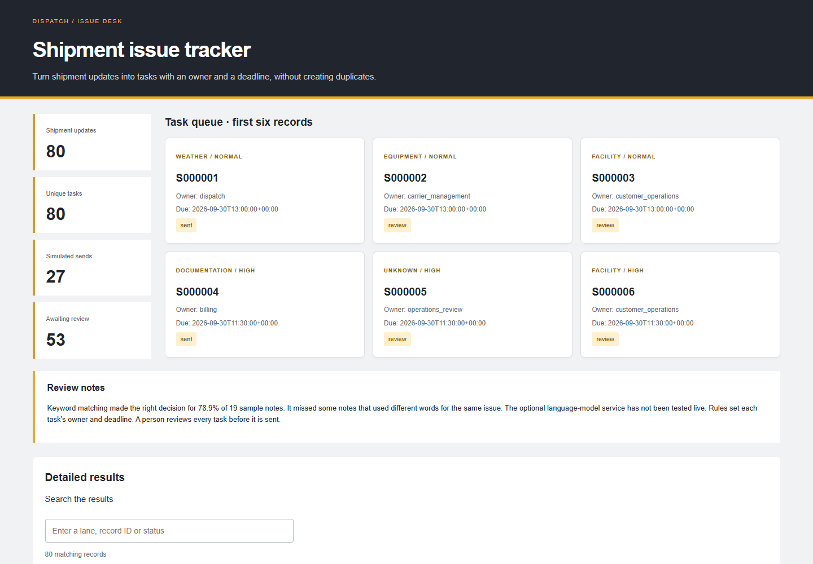
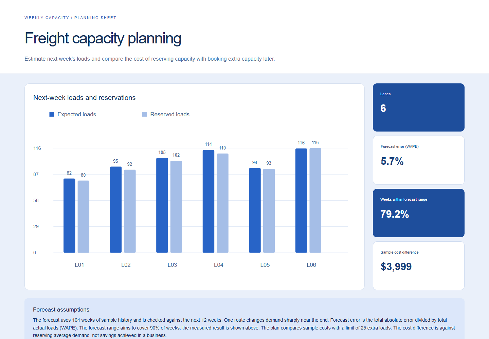
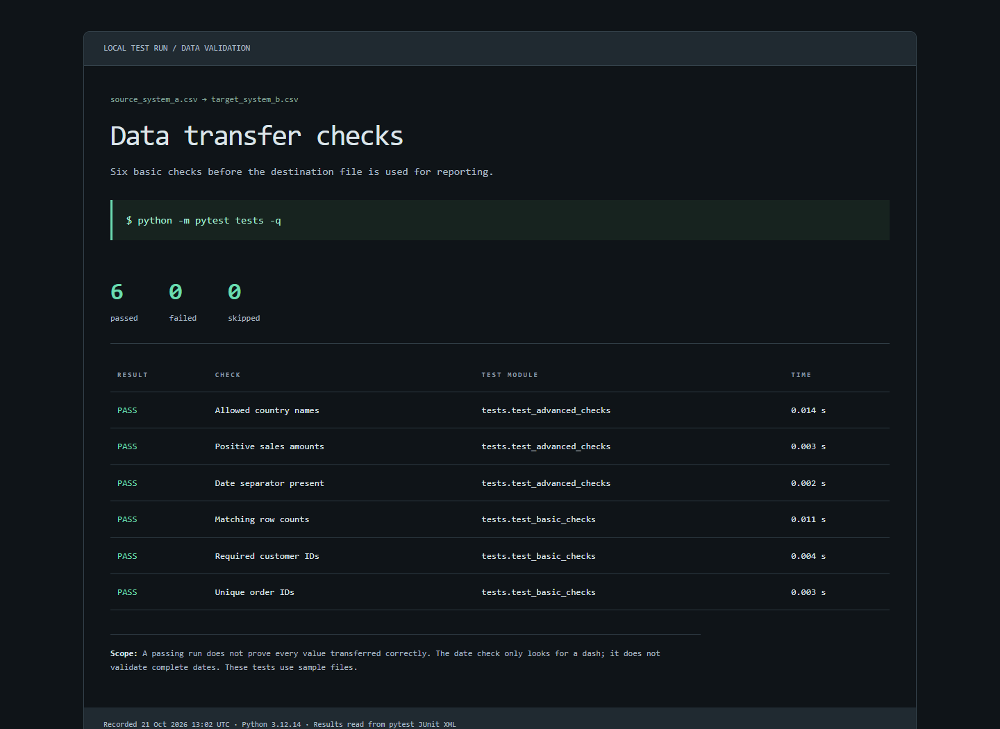

  

  <strong>7+ years in logistics analytics, business reporting and MIS.</strong> 
  Mohali, India

  <a href="https://parijat9.github.io/">Portfolio</a> &nbsp; / &nbsp;
  <a href="https://parijat9.github.io/assets/parijat-anand-resume.pdf">Résumé</a> &nbsp; / &nbsp;
  <a href="https://www.linkedin.com/in/parijat-anand-25123418b">LinkedIn</a> &nbsp; / &nbsp;
  <a href="mailto:parijat.anand123@gmail.com">Email</a>

---

### The work behind the numbers

I work where logistics operations, finance and reporting meet. My focus is customer profitability, billing, fleet performance and the follow-up that keeps daily work moving.

I build reports people can check and workflows people can follow. That often means finding why two figures disagree, deciding which exceptions need attention, or turning a manual handoff into a repeatable process.

**Analysis & reporting** &nbsp; `SQL` `Power BI` `DAX` `Excel` `Tableau` `Python` 
**Automation & delivery** &nbsp; `Power Automate` `Zoho Projects` `ClickUp`

### See the work unfold

Four public projects built around practical logistics and reporting problems. Each includes working code and a report using demonstration data.

<table>
<tr>
<td width="50%" valign="top">

<h3>Freight billing checks</h3>

Compare agreed rates, invoices and payments. Put missing bills and incorrect charges in one review list.

<a href="https://github.com/Parijat9/freight-revenue-controls">Code</a> · <a href="https://parijat9.github.io/reports/revenue.html">Open report</a>
</td>
<td width="50%" valign="top">

<h3>Shipment issue tracker</h3>

Turn shipment updates into proposed tasks with an owner, a deadline and a review step. Catch repeat updates before they create duplicate work.

<a href="https://github.com/Parijat9/shipment-exception-workbench">Code</a> · <a href="https://parijat9.github.io/reports/exceptions.html">Open report</a>
</td>
</tr>
<tr>
<td width="50%" valign="top">

<h3>Freight capacity planning</h3>

Compare expected demand with available capacity. Change the assumptions in Excel and see how the cost changes.

<a href="https://github.com/Parijat9/freight-capacity-planning">Code</a> · <a href="https://parijat9.github.io/reports/capacity.html">Open report</a>
</td>
<td width="50%" valign="top">

<h3>Data transfer checks</h3>

Check source and destination files before reporting. Flag missing records, duplicates and differences in totals.

<a href="https://github.com/Parijat9/data-migration-testing-project">Code</a> · <a href="https://parijat9.github.io/reports/transfer.html">Open report</a>
</td>
</tr>
</table>

<strong>More work: customer reporting and meeting follow-up</strong>

**Customer Intelligence Platform** brings customer revenue and cost reporting into a clearer view for review and planning.

**Action Sync** moves meeting actions into a shared tracker so responsibilities and follow-up are easier to manage.

[Read the project summaries on my portfolio](https://parijat9.github.io/#projects).

### How I approach a problem

**Understand the decision.** Start with the question the team needs answered. 
**Check the records.** Agree on the definitions and investigate differences. 
**Make the process repeatable.** Automate routine steps and keep a review point for uncertain cases.

---

Great conversations often lead to great opportunities. Let's have one. 
<a href="mailto:parijat.anand123@gmail.com">parijat.anand123@gmail.com</a>

